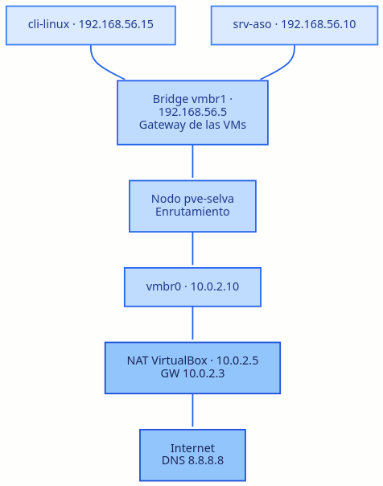

# 02-diagrama-red

## Objetivo
El objetivo de esta fase es planificar el diseño de red para que despues al instalar Proxmox y sus VMs dentro tengan conexion entre si y tambien tengan conexion al exterior.
Esto tambien es importante porque nos ayuda a tener toda nuestro diseño de red planificado antes de instalar Proxmox.

## Tabla Diseño de Red
| Elemento | Nombre | IP | Función | Recursos |
|---|---|---|---|---|
| Nodo Proxmox |pve-selva | 192.168.56.5/24 |Hipervisor |Maquina Virtual |
| Servidor ASO |srv-aso |192.168.56.10/24 |Servicio principal |Maquina Virtual o LXC |
| Cliente |cli-linux |192.168.56.15/24 |Pruebas |Maquina Virtual o LXC |
| Interfaz de gestión |Solo anfitrion |192.168.56.1/24 |Conexion por navegador o SSH al laboratorio |Interfaz VirtualBox |
| Interfaz de salida a internet |NAT VirtualBox |10.0.2.5/24 |Salida a internet |Interfaz VirtualBox |
| Bridge de Proxmox 1 |vmbr0 |10.0.2.10/24 |Salida de VMs a internet |Bridge Proxmox |
| Bridge de Proxmox 2 |vmbr1 |192.168.56.5/24 |Conexion ente Vms y gestion del nodo |Bridge Proxmox |
| Red de laboratorio |Laboratorio Proxmox |192.168.56.0/24 |Red principal de el Laboratrio |Red VirtualBox |
| Gateway |vmbr1, vmbr0 |192.168.56.5/24, 10.0.2.3/24 |Salida de maquinas virtuales al exterior |Gateway salida a NAT |
| DNS 1 |Google |8.8.8.8 |Servidor DNS para resolver nombres de dominio |Servidor DNS |
| DNS 2 |DNS NAT|10.0.2.5 |Servidor DNS para poder salir a internet |Servidor DNS |
| Puerto 1 |TCP 8006 | |Administración web de Proxmox  |Puerto administracion web |
| Puerto 2 |TCP 22 | |Administración SSH  |Puerto SSH |

## Diagrama de Red

## Incidencias
No ha habido ninguna incidencia en la realizacion de esta sesion.

## Conclusion
Con esta sesion lo que hemos realizado ha sido nuestro diseño de red antes de instalar todo. Ha venido muy bien realizarlo para tener todo preparado y despues solo nos queda instalarlo y configurarlo.

[Volver al indice](../README.md)
