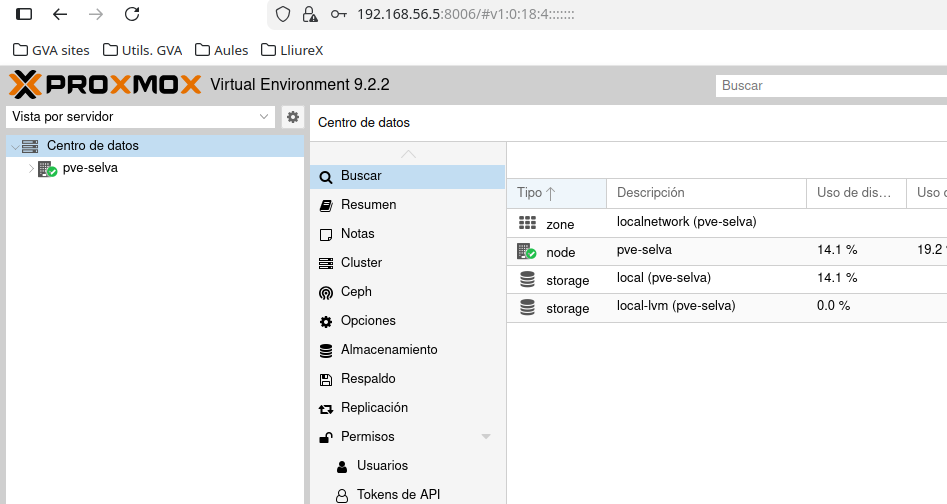
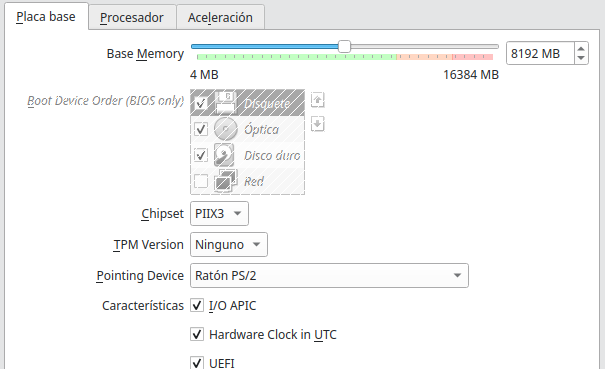
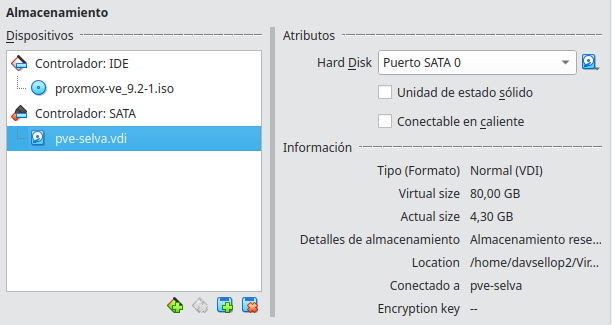
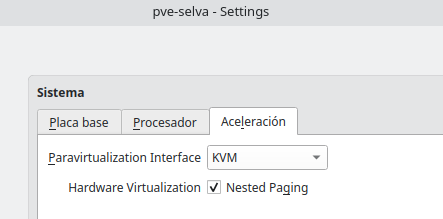
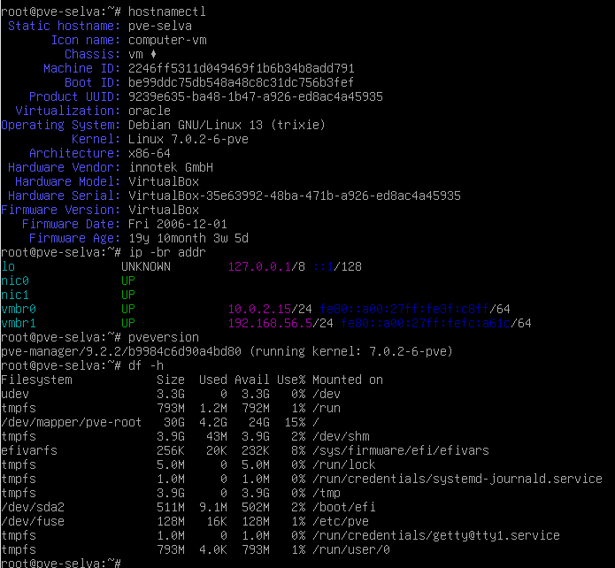
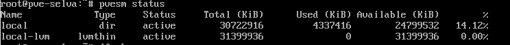
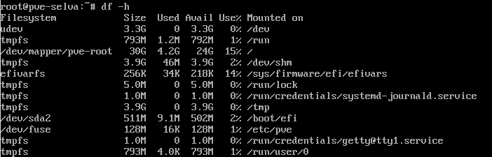

# 03-instalacion-proxmox

## Objetivo
### Fase 3. Instalación de Proxmox


El objetivo de esta sesion ha sido instalar Proxmox en una maquina Virtual de VirtualBox configurando la Ram, CPU y espacio de disco correctamente y los adaptadores necesarios para la practica (Red Nat y Solo anfitrion). Al instalarlo he tenido que configurar el fichero de interfaces para posteriormente conectarme via web a proxmox.

### Fase 4. Configuración base del nodo¶


## Procedimiento

### Fase 3. Instalación de Proxmox

Paso 1 - Lo primero que he hecho ha sido crear la maquina virtual pve-selva con la iso de Proxmox, configurando 8 GB de RAM, 2CPUs y un disco duro de 80 Gib. Una vez creada he activado la opcion Nested VT-x/AMD-V para permitir la virtualizacion anidada, en paravirtualization interface lo tengo puesto en KVM y el controlador SATA conectado al disco lo he puesto de tipo virtio-scsi.

Paso 2 - En este paso he configurado los dos adaptadores de red, el adaptador 1 es Red NAT (modo promiscuo y dhcp desactivado) para la salida a internet y el adaptador 2 he creado un adaptador de red solo anfitrion (modo promiscuo) con la ip 192.168.56.1. Por ultimo los he activado en la maquina de Proxmox en Virtualbox

Paso 3 - Una vez hecho todo lo anterior, he iniciado la instalacion de Proxmox configurando el hostname, la direccion IP de gestion (En este momento ha sido la de Red NAT para poder instalarlo, mas adelante lo cambio), la puerta de enlace y el servidor DNS.

Paso 4 - Una vez finalizada la instalacion he entrado en el fichero '/etc/network/interfaces' para configurar los bridges vmbr0 y vmbr1, enlazandolos con los adaptadores Red Nat (vmbr0) y solo anfitrion (vmbr1).

Paso 5 - Al aplicar la configuracion anterior, lo ultimo que he hecho ha sido cambiar la IP de gestion a la 192.168.56.5 en el fichero /etc/hosts, ya que antes estaba puesta la ip 10.0.2.15 por la instalacion.

Paso 6 - En este paso poniendo https://192.168.56.5:8006 en el navegador he entrado a mi panel de Proxmox.

### Fase 4. Configuración base del nodo¶

1. Revisar donde se guarda cada cosa

En DataCenter > Storage podemos ver que tenemos local y local-lvm. 

Local es de tipo directorio, este almacenamiento se utiliza para guardar imagenes de ISO de sistemas operativos, plantillas de contenedores y copias de seguridad de las maquinas virtuales.

Local-lvm es de tipo LVM-thin, este almacenamiento se utiliza para almacenar los discos de las maquinas virtuales y almacenamiento de los contenedores.

El espacio de local es de unos 30 GB, 4,3 GB utilizados y unos 24,8 GB disponibles y el espacio de local-lvm es de unos 31,4 GB, no tiene nada utilizado, por lo tanto ese es su espacio disponible.

Son dos almacenamientos diferentes y cada uno sirve para guardar cosas distintas.

Tambien he creado una carpeta que admita backup.

He comprobado que tengo suficiente espacio en el disco de mi ordenador, ya que aunque en Proxmox nos diga que el disco (VDI) tiene 80GB no significa que pueda ocupar hasta esa cantidad si el equipo anfitrion no tiene ese espacio disponible en su disco duro fisico, si ocurre esto nuestro sistema pueda caer y es un riesgo muy importante.

Tambien hay que tener en cuenta que si las copias de seguridad se guardan en el mismo disco duro que usamos para nuestro laboratorio, un fallo en el disco provoca que perdamos los discos de nuestras maquinas virtuales y las copias de seguridad.
Por eso es recomendable realizar las copias de seguridad en otro disco duro distinto.


## Comandos usados

### Fase 3. Instalación de Proxmox

```bash
ip -br link
ip -br addr

nano /etc/network/interfaces
ifreload -a

nano etc/hosts

hostnamectl
pveversion
df -h

ip route replace default via 10.0.2.1 dev vmbr0
nano /etc/network/interfaces
ifreload -a
```
### Fase 4. Configuración base del nodo¶
```bash
pvesm status

df -h
```

## Evidencias

### Fase 3. Instalación de Proxmox

Captura de el panel de Proxmox:




Captura de recursos RAM, almacenamiento, CPUs, opcion Nested VT-x/AMD-V activada y KVM :









Captura de adaptadores y su configuracion:


Salida de comandos pedidos:



### Fase 4. Configuración base del nodo¶







## Incidencias
### Fase 3. Instalación de Proxmox

En esta sesion he tenido un problema y es que teniendo toda la red configurada correctamente, mi nodo Proxmox no tenia conexion a internet. 
Me he dado cuenta de el fallo y lo que pasaba es que el gateway de la Red Nat estaba mal configurado. Lo tenia puesto en la 10.0.2.2 y he tenido que poner la 10.0.2.1, una vez puesta la gateway correcta he comprobado que ya tenia conexion a internet. Se puede ver en los ultimos conmandos utilizados lo que he hecho para cambiarla, en nano /etc/network/interfaces he cambiado 10.0.2.2 en gateway de vmbr0 por 10.0.2.1
Tambien he actualizado la captura de /etc/network/interfaces ya con la gateway configurada correctamente.

### Fase 4. Configuración base del nodo¶


## Conclusion
### Fase 3. Instalación de Proxmox

En esta sesion he dejado instalado Proxmox en una maquina virtual en Virtualbox con la asignacion de recursos y adaptadores de red correspondientes para su funcionamiento. Por ultimo, he comprobado que se puede acceder al panel web de gestion de Proxmox.

### Fase 4. Configuración base del nodo¶


[Volver al indice](../README.md)
