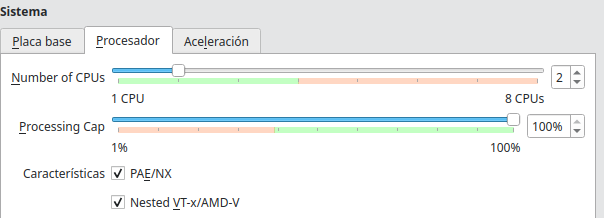
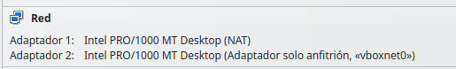
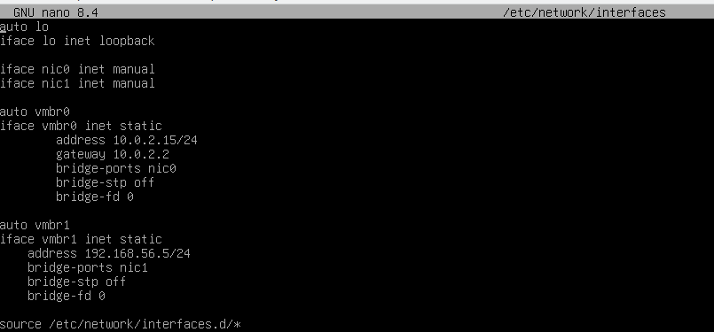

# 03-instalacion-proxmox

## Objetivo
El objetivo de esta sesion ha sido instalar Proxmox en una maquina Virtual de VirtualBox configurando la Ram, CPU y espacio de disco correctamente y los adaptadores necesarios para la practica (Nat Y Solo anfitrion). Al instalarlo he tenido que configurar el fichero de interfaces para posteriormente conectarme via web a proxmox.
## Procedimiento
Paso 1 - Lo primero que he hecho ha sido crear la maquina virtual pve-selva con la iso de Proxmox, configurando 8 Gib de RAM, 2CPUs y un disco duro de 80 Gib. Una vez creada he activado la opcion Nested VT-x/AMD-V para permitir la virtualizacion anidada.

Paso 2 - En este paso he configurado los dos adaptadores de red, el adaptador 1 es NAT para la salida a internet y el adaptador 2 he creado un adaptador de red solo anfitrion con la ip 192.168.56.1. Por ultimo los he activado en la maquina de Proxmox en Virtualbox

Paso 3 - Una vez hecho todo lo anterior, he iniciado la instalacion de Proxmox configurando el hostname, la direccion IP de gestion (En este momento ha sido la NAT para poder instalarlo, mas adelante lo cambio), la puerta de enlace y el servidor DNS.

Paso 4 - Una vez finalizada la instalacion he entrado en el fichero '/etc/network/interfaces' para configurar los bridges vmbr0 y vmbr1, enlazandolos con los adaptadores Nat (vmbr0) y solo anfitrion (vmbr1).

Paso 5 - Al aplicar la configuracion anterior, lo ultimo que he hecho ha sido cambiar la IP de gestion a la 192.168.56.5 en el fichero /etc/hosts, ya que antes estaba puesta la ip 10.0.2.15 por la instalacion.

Paso 6 - En este paso poniendo https://192.168.56.5:8006 en el navegador he entrado a mi panel de Proxmox.

## Comandos usados

```bash
ip -br link
ip -br addr

nano /etc/network/interfaces
ifreload -a

nano etc/hosts

hostnamectl
pveversion
df -h
```

## Evidencias
Captura de el panel de Proxmox:


Captura de recursos RAM, almacenamiento, CPUs y opcion Nested VT-x/AMD-V activada :





Captura de adaptadores y su configuracion:






Salida de comandos pedidos:


## Incidencias
En esta sesion no ha habido ninguna incidencia.

## Conclusion
En esta sesion he dejado instalado Proxmox en una maquina virtual en Virtualbox con la asignacion de recursos y adaptadores de red correspondientes para su funcionamiento. Por ultimo, he comprobado que se puede acceder al panel web de gestion de Proxmox.
[Volver al indice](../README.md)
